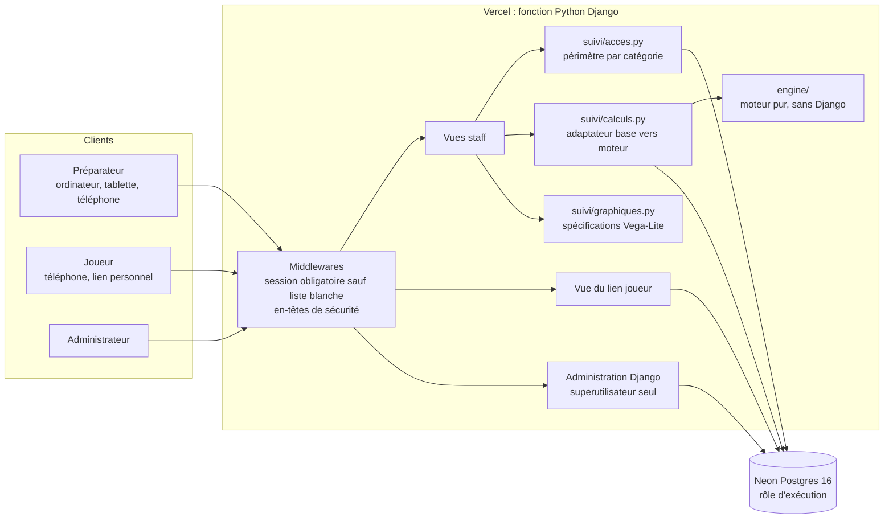
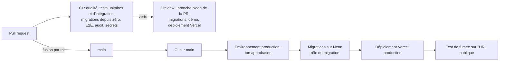
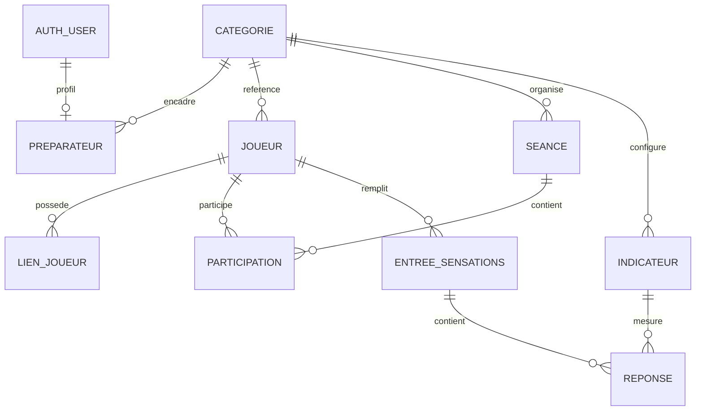
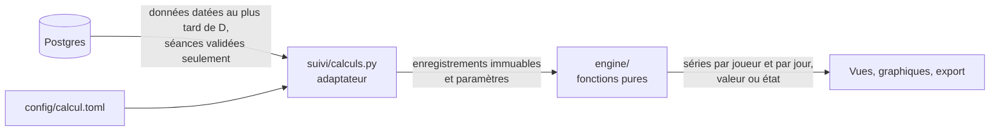

# Architecture

| Version | Date | Statut |
| --- | --- | --- |
| 1.0 | 2026-10-12 | Validé |

Ce document couvre la stack technique, les composants, le modèle de données, le modèle d'accès, l'emplacement du moteur de calcul et l'arborescence du code. Les choix structurants sont justifiés dans les ADR 0001 à 0006.

## 1. Principes

1. **Rendu serveur, base jamais exposée.** Le navigateur ne parle qu'à l'application Django ; seule l'application se connecte à Postgres. Il n'existe ni API publique, ni clé côté navigateur ([ADR-0002](adr/0002-django-et-rendu-serveur.md), [ADR-0005](adr/0005-controle-d-acces-applicatif.md)).
2. **Refus par défaut à chaque niveau.** Toute vue exige une session, sauf une liste blanche explicite ; tout accès aux données passe par une couche unique de périmètre ; le rôle Postgres de l'application ne peut pas modifier le schéma.
3. **Une seule implémentation des formules.** Le moteur de calcul est un module Python pur, sans Django, alimenté par un adaptateur qui ne lit que les données datées au plus tard de la date de calcul ([ADR-0004](adr/0004-moteur-de-calcul-en-python.md)).
4. **Rien n'est stocké qui puisse se recalculer.** Charges et z-scores sont recalculés à chaque consultation : une correction de saisie se répercute sans traitement supplémentaire.
5. **Tout tourne en local et en CI sans compte cloud.** Les services gratuits (Vercel, Neon) ne servent qu'au déploiement ([ADR-0003](adr/0003-hebergement-vercel-et-neon.md)).

## 2. Stack technique

| Couche | Choix | Pourquoi | Alternative écartée | Coût | Comment ça se teste |
| --- | --- | --- | --- | --- | --- |
| Langage | Python 3.12 | Ton niveau 3 ; version prise en charge par Django 5.2 et par le runtime Python de Vercel. Un seul langage pour l'application, le moteur et les tests. | TypeScript : niveau 0, contraire à « livrer avant tout ». | 0 € | Local et CI : `ruff`, `mypy`, `pytest` sur la version épinglée dans `.python-version`. |
| Framework web | Django 5.2 LTS | Fournit d'origine l'authentification, l'administration, l'ORM et les migrations, la validation des formulaires, la protection CSRF et le refus par défaut des vues (`LoginRequiredMiddleware`). Moins de dépendances, donc moins de code à sécuriser. Support de sécurité jusqu'en avril 2028. | Next.js et Supabase (piste de la première tentative) : TypeScript niveau 0, base exposée au navigateur, ce qui a produit les failles 1 et 2 de l'annexe A. FastAPI : il faudrait assembler soi-même authentification, administration, migrations et formulaires. | 0 € | Client de test Django avec `pytest-django`, sur une vraie base. |
| Interface | Gabarits Django, feuille de style Pico CSS copiée dans le dépôt, un petit fichier JavaScript sans framework pour la grille | La grille tient avec des champs HTML ordinaires : la touche Tab parcourt déjà les cellules ligne après ligne, et une vingtaine de lignes de JavaScript suffisent pour le code couleur. Aucune chaîne de build. | Framework JavaScript (React, Vue) : niveau 0 et chaîne de build. Tailwind : demande Node pour compiler. HTMX : pas de besoin immédiat, il ne sera ajouté que si une PR le justifie. | 0 € | Tests de bout en bout Playwright sur ordinateur, tablette et téléphone (E1, E2). |
| Graphiques | Vega-Lite rendu par `vega-embed`, fichiers copiés dans le dépôt ; spécifications construites en Python sous forme de dictionnaires | Grammaire déclarative, naturelle pour un statisticien ; nuage de points avec gradient, barres et heatmap sans extension. Aucune dépendance Python. | Plotly : bibliothèque JavaScript plus lourde. Chart.js : configuration impérative, et heatmap par extension. | 0 € | Tests unitaires : les valeurs de chaque spécification égalent les sorties du moteur. Chaque graphique est doublé d'un tableau de valeurs, lu par le test E3. |
| Base de données | PostgreSQL 16 : Docker en local, conteneur de service en CI, Neon en production | Ta compétence SQL ; même moteur partout ; image `postgres:16` déjà installée ; version proposée par Neon. | SQLite pour les tests : contraintes et types différents de la production, contraire à la règle « vraie base » (cadrage 7.7). | 0 € | Tests d'intégration sur une base créée et migrée à chaque exécution. |
| Migrations | Migrations Django ; contraintes CHECK et UNIQUE déclarées dans les modèles ; déclencheurs en SQL quand une règle traverse deux tables | Migrations générées, rejouables et vérifiables (`makemigrations --check`). | Fichiers SQL écrits à la main (première tentative) : jamais exécutés. | 0 € | CI : `migrate` sur base vide, chargement des données de démonstration, `makemigrations --check` (D3). |
| Fichiers | Aucun stockage de fichiers en V1 | Les exports CSV sont générés à la volée. | Stockage d'objets : aucun besoin. | 0 € | — |
| Authentification du staff | `django.contrib.auth`, hachage PBKDF2 par défaut ; comptes créés par l'administrateur ; aucune route d'inscription | Mécanisme éprouvé, sans dépendance. L'inscription n'existe pas, donc rien à fermer. | Fournisseur externe (Supabase Auth, Auth0) : compte cloud, et la configuration d'inscription ouverte de la première tentative (annexe A, n° 5). | 0 € | A1, A6 sur le catalogue des URL ; tests de connexion. |
| Lien joueur | Jeton aléatoire de 256 bits dans l'URL ; seule son empreinte SHA-256 est stockée ; révocable et régénérable | Un hachage rapide suffit pour un secret de cette entropie, et l'empreinte peut être indexée pour la recherche ([ADR-0006](adr/0006-lien-joueur-a-jeton-hache.md)). | Lien magique par courriel ou SMS : collecte de coordonnées, service tiers. Jeton signé sans stockage : non révocable. | 0 € | A4, A5 ; test de catalogue qui vérifie qu'aucune colonne ne contient de jeton en clair. |
| Hébergement de l'application | Vercel, offre Hobby, runtime Python (Django pris en charge sans configuration) | Gratuit sans carte bancaire ; démarrage à froid de l'ordre de quelques secondes ; déploiements de preview. | Render gratuit : mise en veille après 15 minutes et réveil d'environ une minute, rédhibitoire pour un joueur qui ouvre son lien. Fly.io, Cloud Run, Scaleway : carte bancaire exigée. | 0 € ; usage personnel non commercial uniquement | Test de fumée après chaque déploiement ; tests d'accès rejoués contre l'URL publique en phase 7. |
| Hébergement de la base | Neon, offre Free, région Europe | Mise à l'échelle zéro automatique, sans pause manuelle ; branches de base gratuites pour les previews ; pas de carte bancaire. | Supabase gratuit : pause après 7 jours d'inactivité avec réactivation manuelle, sans sauvegarde quotidienne. Render Postgres gratuit : supprimé 30 jours après sa création. | 0 € ; 0,5 Go, 100 CU-heures par mois, restauration sur 6 heures | Migrations rejouées sur la branche de chaque PR ; restauration testée en phase 7. |
| Déploiement | GitHub Actions et CLI Vercel. Migrations appliquées par la CI avec le rôle de migration ; production derrière l'environnement GitHub `production`, qui demande ton approbation ; preview par PR sur une branche Neon dédiée | Déploiement indépendant de ton poste ; aucune migration sur la base déployée sans ton accord ; les identifiants de migration ne sont jamais confiés à Vercel. | Intégration Git automatique de Vercel avec migrations dans le build : migrations hors de ton contrôle, identifiants de propriétaire du schéma stockés chez l'hébergeur. | 0 € ; minutes de CI illimitées en dépôt public | Le workflow de déploiement se termine par un test de fumée ; la preview sert à la recette sur téléphone. |
| Environnement et dépendances | uv, `uv.lock` versionné, `.python-version` ; développement dans WSL 2 (Ubuntu), dépôt dans le système de fichiers Linux | Tu maîtrises uv ; installations reproductibles ; mêmes conditions que la CI (Ubuntu) ; hors de OneDrive. | pip et `requirements.txt` sans verrou ; dépôt sous Windows : lent avec Docker, et proche des dossiers synchronisés. | 0 € | Critère de phase 1 : un clone neuf s'installe et passe ses tests avec les seules commandes du README. |
| Lint et format | Ruff (lint et format) | Un seul outil rapide à la place de trois. | Black, isort et Flake8. | 0 € | Job CI `qualite`. |
| Typage | mypy avec `django-stubs` ; mode strict sur `engine/` | Le moteur est le cœur du produit : typage strict là où une erreur coûte le plus cher. | Pyright : bon outil, mais l'écosystème Django s'appuie sur les extensions mypy. | 0 € | Job CI `qualite`. |
| Tests | pytest, `pytest-django`, `pytest-cov`, Playwright pour Python (Chromium) | Un seul lanceur pour tous les niveaux ; Playwright émule tablette et téléphone. | Selenium : plus lent et plus fragile. Cypress : JavaScript. | 0 € | Voir [03-strategie-tests.md](03-strategie-tests.md). |
| CI | GitHub Actions ; ruleset sur `main` : PR obligatoire, jobs de CI obligatoires, poussée forcée et suppression interdites, aucun contournement | Dépôt public : protection de branche disponible et minutes illimitées ([ADR-0001](adr/0001-depot-public-et-protection-de-main.md)). | Hooks Git locaux seuls : contournables, c'est la règle écrite que l'annexe A, n° 16, voulait remplacer. | 0 € | Démonstration en phase 1 : une PR dont un test échoue ne peut pas être fusionnée. |
| Secrets | `.env` local, ignoré par Git et dont la lecture est refusée à Claude Code ; `.env.example` versionné ; secrets d'environnement GitHub ; variables Vercel marquées « Sensitive » | Aucun secret dans le dépôt public. Vercel a subi en avril 2026 un incident qui a exposé, pour une partie de ses clients, les variables non marquées « Sensitive ». | Fichier de secrets chiffré dans le dépôt : complexité inutile pour quatre secrets. | 0 € | Scan des secrets (gitleaks) en CI ; `.env.example` comparé aux variables lues par les réglages. |
| Audit des dépendances | `pip-audit` en CI ; alertes Dependabot | Répond à l'annexe A, n° 6. | Audit manuel : non automatique, donc écarté (cadrage, règle 7). | 0 € | Job CI `audit`, bloquant sur toute vulnérabilité connue. |
| Moteur de calcul | Package Python pur `engine/`, bibliothèque standard seulement | Une implémentation, testable sans base et via la base, paramètres injectés ([ADR-0004](adr/0004-moteur-de-calcul-en-python.md)). | SQL avec fonctions fenêtrées ; pandas. | 0 € | Cas C1 à C15 sur le jeu de référence ; seuil de couverture dédié. |
| Paramètres de calcul | Fichier `config/calcul.toml` versionné, lu avec `tomllib` et validé au démarrage | Fenêtres et seuils modifiables sans toucher aux formules ; chaque changement passe par une PR testée. Les poids des indicateurs, propres à chaque catégorie, sont des données en base. | Table de paramètres modifiable en ligne : un changement échapperait aux tests et à l'historique Git. | 0 € | Test de validation du fichier ; tests du moteur avec des paramètres injectés. |
| Données de démonstration | Commande Django `generer_demo` à graine fixe, sans bibliothèque de données factices | Reproductible ; aucune donnée réelle possible. | Faker : dépendance sans besoin réel. | 0 € | D3 : chargées depuis une base vide à chaque PR. |

## 3. Composants





## 4. Modèle de données



| Table | Colonnes | Contraintes et index |
| --- | --- | --- |
| `categorie` | `id`, `code`, `libelle`, `jours_questionnaire`, `active` | `code` unique |
| `preparateur` | `id`, `user_id` → `auth_user`, `categorie_id` | `user_id` unique (un profil par compte, clé étrangère vers les comptes : annexe A, n° 18) |
| `joueur` | `id`, `nom`, `prenom`, `date_naissance`, `categorie_reference_id`, `actif`, `created_at`, `updated_at`, `updated_by_id` | `nom` et `prenom` non vides |
| `lien_joueur` | `id`, `joueur_id`, `token_hash`, `created_at`, `created_by_id`, `revoked_at` | `token_hash` unique ; index unique partiel sur `joueur_id` quand `revoked_at` est nul (un lien actif au plus) |
| `seance` | `id`, `categorie_organisatrice_id`, `date`, `type`, `duree_min`, `statut`, `created_at`, `created_by_id`, `updated_at`, `updated_by_id`, `validated_at` | `type` dans {foot, musculation, yoga, autre} ; `statut` dans {brouillon, validee} ; `duree_min` entre 1 et 300 ([ADR-0007](adr/0007-echelle-rpe-et-formule-de-charge.md)) |
| `participation` | `id`, `seance_id`, `joueur_id`, `rpe_cardio`, `rpe_musculaire`, `rpe_teta`, `updated_at`, `updated_by_id` | (`seance_id`, `joueur_id`) unique (D2) ; chaque RPE nul ou entier entre 0 et 10 (D1) ; déclencheur : aucune participation incomplète dans une séance validée ([ADR-0008](adr/0008-cycle-de-vie-des-saisies.md)) |
| `indicateur` | `id`, `categorie_id`, `code`, `libelle`, `type`, `borne_min`, `borne_max`, `sens`, `poids`, `inclus_score`, `ordre`, `actif` | (`categorie_id`, `code`) unique ; `borne_min` < `borne_max` ; `poids` ≥ 0 ; `type` et `sens` dans des listes fermées ; échelle non modifiable une fois des réponses enregistrées ([ADR-0016](adr/0016-evolution-de-la-configuration.md)) |
| `entree_sensations` | `id`, `joueur_id`, `date`, `created_at`, `updated_at`, `updated_by_id` | (`joueur_id`, `date`) unique (D2) |
| `reponse` | `id`, `entree_id`, `indicateur_id`, `valeur` | (`entree_id`, `indicateur_id`) unique ; déclencheur : `valeur` dans les bornes de l'indicateur (D1) |

Notes :

- `updated_by_id` est nul quand l'auteur est un joueur passant par son lien.
- `updated_at` est maintenu par Django (`auto_now`) ; un test vérifie qu'il change à chaque modification (annexe A, n° 18).
- Aucune vue SQL ni fonction exposée en V1. Un test de catalogue détecte les index en double.
- Les blessures n'ont pas de table en V1 : rien n'est créé « pour plus tard ».

**Rôles Postgres.** Deux rôles, créés en local par le script d'initialisation du conteneur, en CI par une étape du workflow, et sur Neon à la mise en place :

| Rôle | Droits | Utilisé par |
| --- | --- | --- |
| Rôle de migration | Propriétaire du schéma | Tests, migrations locales, étape de migration de la CI. Jamais par l'application déployée. |
| Rôle d'exécution | `SELECT`, `INSERT`, `UPDATE`, `DELETE` sur les tables de l'application, accordés par défaut à chaque nouvelle table ; aucun droit de modifier le schéma | L'application déployée (seul identifiant connu de Vercel) |

Aucun droit n'est accordé à `PUBLIC`. Le détail de la mise en œuvre est l'objet de la phase 2.

## 5. Modèle d'accès

| Qui | Peut lire | Peut écrire | Mécanisme | Tests |
| --- | --- | --- | --- | --- |
| Visiteur non connecté | La page de connexion et les fichiers statiques | Rien | `LoginRequiredMiddleware` : toute vue exige une session, sauf la liste blanche (connexion, lien joueur, contrôle de santé) ; base non exposée | A1, A2, A6 |
| Joueur, par son lien | Les indicateurs actifs de sa catégorie de référence ; son entrée du jour | Son entrée du jour : création, puis modification jusqu'à 23 h 59, heure de Paris | Le jeton désigne un joueur ; une seule vue l'accepte ; aucune autre donnée n'est atteignable | A4, A5 |
| Préparateur d'une catégorie | Les joueurs dont c'est la catégorie de référence, toutes leurs participations (y compris aux séances d'autres catégories) et leurs entrées de sensations ; l'annuaire minimal (nom, prénom, catégorie de référence des joueurs actifs) ; les participations aux séances qu'il organise | Ses joueurs (création, modification, archivage) ; les séances de sa catégorie et leurs participations, joueurs invités compris ; les liens de ses joueurs ; les corrections prévues par l'[ADR-0008](adr/0008-cycle-de-vie-des-saisies.md) | Couche unique `suivi/acces.py` : toute vue staff obtient ses requêtes par elle ; vérification du profil préparateur sur toutes les URL staff | A3 |
| Administrateur | Tout | Le référentiel, les comptes staff, les joueurs, les indicateurs ; la suppression définitive d'un joueur ([ADR-0009](adr/0009-suppression-et-archivage-d-un-joueur.md)) | Administration Django, réservée au superutilisateur | A6, D4 |

Règles de détail :

- Un préparateur n'a jamais `is_staff = True` : l'administration Django lui est fermée.
- Pour un joueur invité, le préparateur organisateur ne voit ni l'historique, ni les charges calculées, ni les sensations du joueur (règle R24, décidée le 2026-10-12).
- La configuration des indicateurs par le préparateur est reportée après la V1 : en V1, seul l'administrateur la modifie.
- Les réponses portent les en-têtes `Referrer-Policy: no-referrer`, `X-Frame-Options: DENY`, une politique de sécurité du contenu limitée à l'origine du site et, sur la page du lien joueur, `Cache-Control: no-store`.

## 6. Emplacement du moteur de calcul

Le moteur vit dans le code applicatif, sous la forme d'un package Python pur ([ADR-0004](adr/0004-moteur-de-calcul-en-python.md)).



- `engine/` n'importe jamais Django ; un test le vérifie en analysant les imports.
- L'adaptateur est le seul endroit qui lit la base pour le moteur. Il filtre les séances validées (C5) et les données datées au plus tard de la date de calcul (C9).
- Chaque résultat est soit une valeur, soit un état explicite (`HISTORIQUE_INSUFFISANT`, `NON_CALCULABLE`) : l'interface n'a rien à recalculer.
- Volume : 30 joueurs × environ 400 jours, avec quelques opérations par jour : le calcul à la demande prend quelques millisecondes. Une mise en cache ne sera envisagée que sur mesure, avec une ADR.

## 7. Arborescence du code

Arborescence cible : chaque dossier n'est créé qu'avec son premier fichier.

```
.
├── .claude/settings.json          permissions de Claude Code
├── .github/
│   ├── pull_request_template.md
│   └── workflows/                 ci.yml, preview.yml, deploy.yml
├── config/                        projet Django : settings.py, urls.py, wsgi.py, calcul.toml
├── suivi/                         application Django
│   ├── models.py
│   ├── acces.py                   périmètre de chaque profil
│   ├── calculs.py                 adaptateur base vers moteur
│   ├── graphiques.py              spécifications Vega-Lite
│   ├── forms.py
│   ├── views/                     staff.py, joueur.py
│   ├── management/commands/       generer_demo.py
│   ├── migrations/
│   ├── templates/suivi/
│   └── static/suivi/              css/, js/, vendor/ (Pico, Vega)
├── engine/                        moteur de calcul pur
├── tests/
│   ├── unit/
│   ├── integration/
│   ├── e2e/
│   └── reference/                 jeu de référence et résultats attendus
├── docs/
├── compose.yaml                   Postgres local
├── manage.py
├── pyproject.toml, uv.lock, .python-version
├── .env.example
└── README.md, CLAUDE.md, CHANGELOG.md
```

## 8. Environnement de développement

| Élément | Choix |
| --- | --- |
| Système | WSL 2 (Ubuntu) sur ton Windows 11 ; VS Code ouvert dans WSL, avec l'extension Claude Code |
| Emplacement du dépôt | Système de fichiers Linux, par exemple `~/projets/<depot>`, jamais sous `/mnt/c` ni dans OneDrive |
| Python | 3.12 installé par uv dans WSL ; tes installations Windows ne sont pas utilisées |
| Docker | Docker Desktop avec l'intégration WSL activée |
| Navigateurs de test | Chromium installé par Playwright, avec ses dépendances système |
| Node.js | Non utilisé par l'application ; seule la CI s'en sert, pour la CLI Vercel |

## 9. Correspondance avec l'annexe A du cadrage

| N° | Défaut de la première tentative | Parade | Preuve |
| --- | --- | --- | --- |
| 1 | Règles d'accès actives sur 4 tables sur 9 | Base non exposée ; aucun droit à `PUBLIC` ; refus par défaut des vues | A1, A2 (catalogue des URL et catalogue de la base) |
| 2 | Vues exécutées avec les droits de leur propriétaire | Aucune vue ni fonction exposée ; le test de catalogue refuse toute fonction `SECURITY DEFINER` et toute vue sans `security_invoker` | A1, A2 |
| 3 | Règle filtrée par catégorie organisatrice | Modèle d'accès écrit avant le schéma ; périmètre fondé sur la catégorie de référence ; règle du joueur invité | A3, C10 |
| 4 | Jeton stocké en clair, sans révocation | Empreinte SHA-256, révocation, régénération | A4, A5 |
| 5 | Inscription publique ouverte | Aucune route d'inscription ; comptes créés par l'administrateur | A6 |
| 6 | Framework avec alerte critique | Django LTS ; `pip-audit` bloquant en CI ; Dependabot | Job `audit` |
| 7 | Point courant inclus dans sa référence | Référence arrêtée à la veille | C6 |
| 8 | Une ligne par participation, pas par jour | Calendrier continu par joueur | C2, C3, C4 |
| 9 | Brouillons comptés dans la charge | L'adaptateur ne lit que les séances validées | C5 |
| 10 | Score additionnant des unités différentes | Normalisation par indicateur, moyenne pondérée des réponses présentes | C11, C12, C13 |
| 11 | Aucune contrainte de plage ; RPE obligatoires incompatibles avec le brouillon | Contraintes CHECK et déclencheurs ; RPE facultatifs en brouillon, obligatoires à la validation | D1 |
| 12 | Aucun test, aucune CI | CI complète dès la phase 1 ; migrations rejouées depuis zéro | D3 |
| 13 | Décisions dans des commentaires SQL ; documents citant des fichiers inexistants | Une ADR par décision ; vérification automatique des liens internes de `docs/` en CI | Job `qualite` |
| 14 | Dossiers vides créés d'avance ; commits inexacts | Rien « pour plus tard » ; relecture de chaque PR | Relecture |
| 15 | Contenu du générateur laissé en place | Nettoyage dans la première PR de la phase 1 | Recette de phase 1 |
| 16 | Workflow Git non suivi | Ruleset sur `main`, CI obligatoire | Démonstration de phase 1 |
| 17 | Dépôt dans OneDrive | Dépôt dans WSL | Critère de phase 1 |
| 18 | Pas de clé étrangère vers les comptes, index en double, date de mise à jour figée, aucune suppression de joueur | Clé étrangère vers `auth_user` ; test de catalogue des index ; test de `updated_at` ; suppression définie | D4 et tests de schéma |

## Sources

Limites vérifiées le 2026-10-12 :

- Vercel, prise en charge de Django : https://vercel.com/changelog/zero-configuration-django-support.md
- Vercel, offre Hobby et usage non commercial : https://vercel.com/docs/plans/hobby et https://vercel.com/docs/limits/fair-use-guidelines
- Vercel, incident d'avril 2026 : https://vercel.com/kb/bulletin/vercel-april-2026-security-incident
- Neon, limites de l'offre Free : https://neon.com/faqs/free-plan-limits-and-quotas
- Supabase, mise en pause des projets gratuits : https://supabase.com/docs/guides/platform/free-project-pausing
- Render, offre gratuite : https://render.com/docs/free
- GitHub, rulesets et environnements : https://docs.github.com/en/repositories/configuring-branches-and-merges-in-your-repository/managing-rulesets/about-rulesets et https://docs.github.com/en/actions/reference/workflows-and-actions/deployments-and-environments
